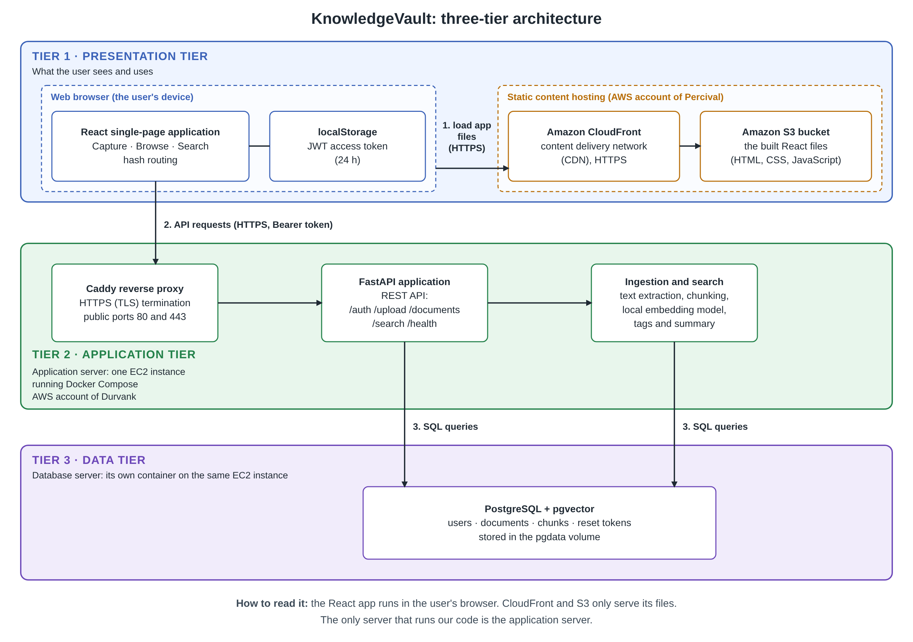

# KnowledgeVault — Architecture

_KV-45 deliverable, brought up to date in Sprint 5 (KV-55, Nov 14, 2026).
Presentation tier: Percival Tapera. Application and data tiers: Durvank
Deorukhkar. It describes the system as deployed on that date. Things that
are planned but not built are listed at the end, under "Not built yet"._

## Overview

KnowledgeVault is a personal document archive with semantic search. A
user signs up, uploads PDFs and text notes, and can then browse the
archive or search it in natural language: the backend extracts each
document's text, splits it into sentence-aware chunks, embeds the
chunks, and answers searches by vector similarity, returning the
best-matching snippet per document. Every document is owned by the
account that uploaded it; one user can never see another's documents
(the API returns 404, not 403, for someone else's document id).

The system is a **three-tier architecture**:

| Tier | What it does | Components | Where it runs |
|---|---|---|---|
| 1. Presentation | What the user sees and uses | React single-page application, with its built files served by static content hosting (CloudFront + S3) | The user's browser; hosting in Percival's AWS account |
| 2. Application | Business logic: sign-in, ingestion, search | Caddy reverse proxy, FastAPI application, ingestion and search code, local embedding model | The application server: one EC2 instance under Docker Compose, in Durvank's AWS account |
| 3. Data | Stores users, documents, chunks and embeddings | PostgreSQL with the pgvector extension | A container on the same EC2 instance, data in the `pgdata` volume |

The presentation tier talks to the application tier only through the REST
API over HTTPS, and only the application tier talks to the data tier.

## System diagram



Diagram source: [`architecture-diagram.svg`](architecture-diagram.svg). The PNG above is exported from it.

Request flow: (1) the browser loads the app files from CloudFront, which serves them from S3; (2) the app sends API requests over HTTPS with the user's Bearer token to the application server, where Caddy passes them to the FastAPI application; (3) the FastAPI application and its ingestion and search code read and write the database.

## Components

### Tier 1, presentation: React app (React 18 + Vite, no router library)

| Piece | File | Responsibility |
|---|---|---|
| App shell | `frontend/src/App.jsx` | Top bar + sidebar layout, backend status indicator, sign-in gate (KV-43), hash routing between tabs (KV-40). Screens stay mounted while hidden so state survives tab switches (KV-31). |
| Capture | `frontend/src/screens/UploadScreen.jsx` | Upload a PDF or enter/paste a note or article; shows the saved record, duplicate warnings and enrichment results (KV-19). |
| Browse | `frontend/src/screens/BrowseScreen.jsx` | Document list with type/tag filters and sorting, master–detail pane with the source excerpt, delete with confirmation (KV-17, KV-22, KV-30). |
| Search | `frontend/src/screens/SearchScreen.jsx` | Semantic search; ranked results with relevance bar, snippet, tags and summary (KV-18, KV-31). |
| Auth | `frontend/src/screens/AuthScreen.jsx` | Sign in / sign up against `/auth/*`; stores the issued token (KV-43). |
| API client | `frontend/src/api.js` | All backend calls. Attaches the Bearer token, converts error bodies into `Error` objects carrying `status`, `detail` and `code`, and triggers the session reset on a 401 from a protected route. |
| Session | `frontend/src/auth.js` | Token storage in localStorage plus the unauthorized-handler bridge between `api.js` and the shell. |
| Excerpts | `frontend/src/excerpt.js` | Pulls a display excerpt out of a document record across the backend's historical field names, with a chunk fallback. |

Quality gates (KV-39, KV-44): a Vitest + React Testing Library suite
covers the session, API client, excerpt helper, auth screen and shell
routing; ESLint runs in CI alongside the tests and a production build.
End-to-end (KV-32): a Playwright suite in `e2e/` drives this frontend in a
real browser against the real API on a throwaway database schema (sign up,
upload, browse, search, delete, account separation) and runs in CI on every
pull request.
Accessibility: labelled controls, visible focus outlines, grouped
filters, and reduced-motion support.

### Tier 2, application: FastAPI application server (Durvank)

- **Auth (KV-42):** signup and login issue a 24-hour JWT (HS256, signed
  with `SECRET_KEY`); passwords are bcrypt-hashed. Every route requires
  the token except `/health`, the sign-in, sign-up and password reset
  routes, and the API docs, and every document query is scoped to the
  token's user.
- **Password reset (KV-53):** `POST /auth/forgot-password` always answers
  the same way, whether or not the email has an account, so it cannot be
  used to find out who is registered. When there is an account it emails
  a single-use link that expires after 30 minutes. Only a SHA-256 hash of
  the link's token is stored (table `password_reset_tokens`), a newer
  link cancels older ones, and the email is sent after the response so
  the request is not slowed. `POST /auth/reset-password` checks the token,
  sets the new password and signs the user in. Mail goes out through
  Amazon SES over SMTP (`mailer.py`); with no mail server configured the
  link is written to the server log instead.
- **Sign-in limits (KV-54):** 5 wrong passwords for one email, or 20 from
  one client address, within 10 minutes, and further attempts get `429
  too_many_attempts` with a `Retry-After` header until the oldest failure
  ages out. Caddy sets the client address, so it cannot be forged. The
  counts live in the single server process's memory (`ratelimit.py`), so a
  restart clears them.
- **One error format (KV-24, KV-52):** every error comes back as
  `{detail, code}`: `detail` is a message the screen can show as it is
  and `code` is stable for the screen to branch on (`invalid_credentials`,
  `file_too_large`, `duplicate_document`, `empty_query`,
  `too_many_attempts` and so on). The full list is in the
  [backend README](../backend/README.md#upload-errors).
- **Ingestion:** upload (limit `MAX_UPLOAD_MB`, 10 by default) stores
  the document, extracts its text, splits it into chunks of at most 800
  characters at sentence boundaries with a small overlap (KV-38), embeds
  each chunk with a local sentence-transformers model (all-MiniLM-L6-v2,
  384 dimensions, no external API), and enriches the record with tags
  and a summary. The model is loaded when the server starts, and
  embedding runs on a worker thread so searches stay responsive during a
  large upload (KV-33). Content identical to one of the user's own
  documents is rejected with `409 duplicate_document` pointing at the
  stored one (KV-25); another user's copy does not count.
- **Search:** the query is embedded and matched against the user's chunk
  vectors in pgvector by cosine similarity; results are grouped to one per
  document, matches below a minimum score (0.25) are hidden, and each
  result carries the passage that matches best and the query words found
  in it (KV-48, `passage.py`), so a screen can show why it matched. A
  blank query or one over 500 characters is refused with a clear error
  (KV-52).
- **Configuration and health (KV-37):** all settings come from
  environment variables (`DATABASE_URL`, `SECRET_KEY`, `CORS_ORIGINS`,
  `MAX_UPLOAD_MB`, ...) and the server refuses to start without the
  required ones. `/health` reports whether the database answers and the
  model is loaded.
- **Packaging and hosting (KV-35, KV-41):** the backend is a Docker
  image with the model baked in. `docker-compose.yml` runs it with
  Postgres for development. `docker-compose.prod.yml` runs three
  containers on one EC2 instance (Caddy, backend, Postgres); only Caddy
  is reachable from the internet, and it obtains the HTTPS certificate
  for the `sslip.io` name automatically. `deploy/smoke_test.py` checks a
  running server end to end (sign up, upload, search, per-user
  isolation, delete). `deploy/deploy.sh` (KV-60) updates the server with one
  command: pull, rebuild, wait until the backend is healthy, check the
  public address.

### Tier 3, data: PostgreSQL + pgvector

PostgreSQL 16 with the pgvector extension and four tables (`users`,
`documents`, `chunks` and `password_reset_tokens`), running in its own container on the application
server's EC2 instance with its data in the `pgdata` Docker volume. The
schema is managed by Alembic migrations (KV-36), applied automatically
when the application starts and safe on databases that already hold
data. Deleting a document cascades to its chunks and embeddings. The
database is not reachable from the internet: only Caddy publishes ports.

## Key flows

**Sign-in.** `POST /auth/login` → `{ access_token }` → stored in
localStorage → sent as `Authorization: Bearer …` on every later call.
A 401 from any protected route clears the token and returns the user
to the sign-in screen; a 401 from the auth calls themselves is shown
as a form error instead (e.g. `invalid_credentials`).

**Upload.** Capture posts the file as multipart form data to
`POST /upload`. The response is the saved record once ingestion and
enrichment complete. Re-uploading content the user already has gets
`409 duplicate_document` with the stored document's id and filename, so
the UI can warn about the duplicate (KV-25).

**Search.** `POST /search { query, limit }` → ranked results, one per
document, each with the matching passage (`snippet`), the query words
found in it (`matched_terms`), similarity score, tags and summary. The
UI normalises scores against the top result for the relevance bar.

**Forgot password.** The user asks for a reset with their email →
`POST /auth/forgot-password` returns the same `202` message every time →
if the email has an account, the application server creates a token, stores
its hash and emails `<FRONTEND_URL>/?reset_token=<token>` through Amazon SES
→ the user opens the link and sends the token with a new password to
`POST /auth/reset-password` → the token is marked used in one atomic
update, the password is replaced and the response is a normal sign-in
(`invalid_reset_token`, `reset_token_expired` and `reset_token_used` are the
failure codes). Sessions that were already open stay valid until their token
expires, up to 24 hours.

## Deployment

The tiers are deployed in two AWS accounts (each teammate's own) for the
demo and deliverables:

- **Application server and data tier:** one EC2 instance (t3.small,
  Ubuntu 24.04) with an Elastic IP, running the three containers above
  (Caddy, the FastAPI application, PostgreSQL) under Docker Compose. Caddy
  serves HTTPS at `https://3-13-43-176.sslip.io` (sslip.io turns the
  server's IP into a hostname, so no domain is needed). Updating is
  `bash deploy/deploy.sh` on the server (it pulls, rebuilds with
  `docker compose -f docker-compose.prod.yml up -d --build`, and waits for
  the health check); database migrations run on start. The server is in
  us-east-2. Setup steps are in `deploy/README.md`.
- **Email:** password reset emails are sent through Amazon SES (SMTP, us-east-2).
  The account is still in the SES sandbox, so mail only reaches verified
  addresses, and the messages can land in a spam folder because they are sent
  from a Gmail address. SES is an external service and is not drawn in the
  diagram.
- **Static content hosting (presentation tier):** the static Vite build
  in an S3 bucket behind CloudFront at
  `https://d33bsamq53gtgw.cloudfront.net`, built with `VITE_API_URL` set
  to the application server's address. Hash routing (KV-40) was chosen
  because it needs no history-API rewrites from static hosting.
- **CORS:** the application server only answers browsers whose origin is in its
  `CORS_ORIGINS` setting, which holds `http://localhost:5173` (local
  development) and the CloudFront address. A new frontend address must be
  added there, followed by `docker compose -f docker-compose.prod.yml up -d`
  on the server.
- **Secrets:** `SECRET_KEY`, the database password and the SES credentials live
  only in the server's `.env`; nothing secret is committed or sent to the
  browser.

## Quality evidence

What was run against the system, and the results, are in
[`testing-and-pilot.md`](testing-and-pilot.md): 376 automated tests, a
104-check pass over the live API, a 29-query search-quality test (29 of 29 with
a relevant source in the top 5) and a pilot with six volunteers (5 of 6
succeeded).

## Not built yet

- Password reset screens in the React app (KV-59); the API side is done.
- Upload progress and a link to the saved document (KV-49), highlighting the
  matched words in results (KV-57) and showing the API's error messages for
  rejected uploads and failed searches (KV-58).
- Sessions are not cancelled when a password changes, and the sign-in
  counters are lost when the server restarts.

## Repository layout

```
frontend/              React SPA (this document's frontend sections)
backend/               FastAPI service, ingestion pipeline, Alembic migrations, tests
e2e/                   Playwright end-to-end tests (browser against the real API)
deploy/                Caddyfile, server setup guide, deploy.sh, smoke test, live functionality pass
eval/                  Search-quality test: documents, queries and expected sources
pilot/                 Sample documents, seed script and results of the pilot sessions
docs/                  Project documents, this file, the user guide, testing summary and QA results
docker-compose.yml     Local development: backend + Postgres
docker-compose.prod.yml  Server: Caddy + backend + Postgres
.github/workflows/     CI: ci.yml (backend tests, Docker build and smoke test),
                       frontend-ci.yml (lint, tests, build),
                       e2e.yml (end-to-end browser tests)
```
