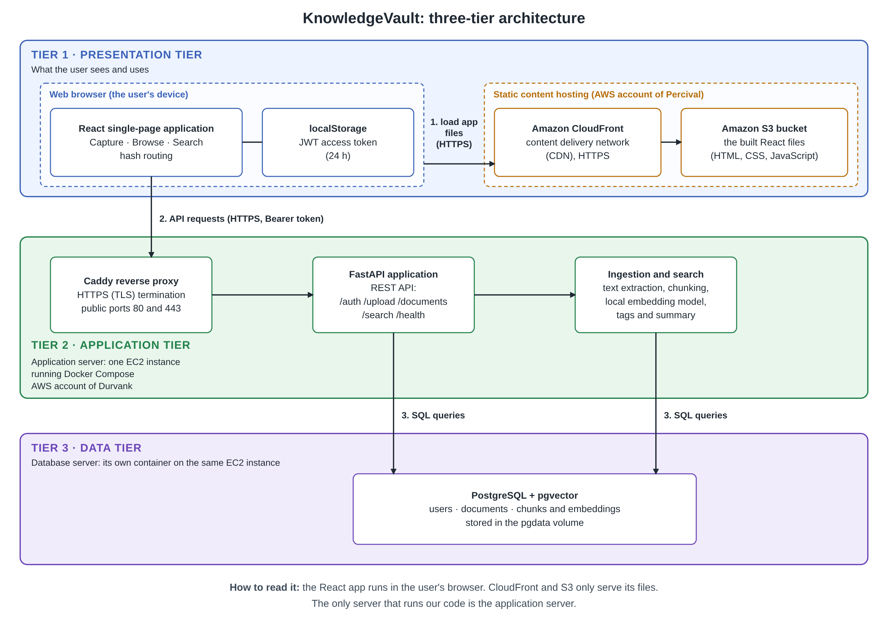

# KnowledgeVault — Architecture

_KV-45 deliverable. Presentation tier: Percival Tapera. Application and data
tiers: Durvank Deorukhkar. This document describes the system as built at
the end of Sprint 4 (Nov 12, 2026); the deployment section describes the
static hosting and the application server as deployed on Nov 8._

## Overview

KnowledgeVault is a personal document archive with semantic search. A
user signs up, uploads PDFs and text notes, and can then browse the
archive or search it in natural language: the backend extracts each
document's text, splits it into sentence-aware chunks, embeds the
chunks, and answers searches by vector similarity, returning the
best-matching snippet per document. Every document is owned by the
account that uploaded it; one user can never see another's documents
(the API returns 404, not 403, for someone else's document id).

The system is a **three-tier architecture**:

| Tier | What it does | Components | Where it runs |
|---|---|---|---|
| 1. Presentation | What the user sees and uses | React single-page application, with its built files served by static content hosting (CloudFront + S3) | The user's browser; hosting in Percival's AWS account |
| 2. Application | Business logic: sign-in, ingestion, search | Caddy reverse proxy, FastAPI application, ingestion and search code, local embedding model | The application server: one EC2 instance under Docker Compose, in Durvank's AWS account |
| 3. Data | Stores users, documents, chunks and embeddings | PostgreSQL with the pgvector extension | A container on the same EC2 instance, data in the `pgdata` volume |

The presentation tier talks to the application tier only through the REST
API over HTTPS, and only the application tier talks to the data tier.

## System diagram



Diagram source: [`architecture-diagram.svg`](architecture-diagram.svg). The PNG above is exported from it.

Request flow: (1) the browser loads the app files from CloudFront, which serves them from S3; (2) the app sends API requests over HTTPS with the user's Bearer token to the application server, where Caddy passes them to the FastAPI application; (3) the FastAPI application and its ingestion and search code read and write the database.

## Components

### Tier 1, presentation: React app (React 18 + Vite, no router library)

| Piece | File | Responsibility |
|---|---|---|
| App shell | `frontend/src/App.jsx` | Top bar + sidebar layout, backend status indicator, sign-in gate (KV-43), hash routing between tabs (KV-40). Screens stay mounted while hidden so state survives tab switches (KV-31). |
| Capture | `frontend/src/screens/UploadScreen.jsx` | Upload a PDF or enter/paste a note or article; shows the saved record, duplicate warnings and enrichment results (KV-19). |
| Browse | `frontend/src/screens/BrowseScreen.jsx` | Document list with type/tag filters and sorting, master–detail pane with the source excerpt, delete with confirmation (KV-17, KV-22, KV-30). |
| Search | `frontend/src/screens/SearchScreen.jsx` | Semantic search; ranked results with relevance bar, snippet, tags and summary (KV-18, KV-31). |
| Auth | `frontend/src/screens/AuthScreen.jsx` | Sign in / sign up against `/auth/*`; stores the issued token (KV-43). |
| API client | `frontend/src/api.js` | All backend calls. Attaches the Bearer token, converts error bodies into `Error` objects carrying `status`, `detail` and `code`, and triggers the session reset on a 401 from a protected route. |
| Session | `frontend/src/auth.js` | Token storage in localStorage plus the unauthorized-handler bridge between `api.js` and the shell. |
| Excerpts | `frontend/src/excerpt.js` | Pulls a display excerpt out of a document record across the backend's historical field names, with a chunk fallback. |

Quality gates (KV-39, KV-44): a Vitest + React Testing Library suite
covers the session, API client, excerpt helper, auth screen and shell
routing; ESLint runs in CI alongside the tests and a production build.
End-to-end (KV-32): a Playwright suite in `e2e/` drives this frontend in a
real browser against the real API on a throwaway database schema (sign up,
upload, browse, search, delete, account separation) and runs in CI on every
pull request.
Accessibility: labelled controls, visible focus outlines, grouped
filters, and reduced-motion support.

### Tier 2, application: FastAPI application server (Durvank)

- **Auth (KV-42):** signup and login issue a 24-hour JWT (HS256, signed
  with `SECRET_KEY`); passwords are bcrypt-hashed. Every route requires
  the token except `/health`, `/auth/signup`, `/auth/login` and the API
  docs, and every document query is scoped to the token's user. Errors
  come back as `{detail, code}` (for example `invalid_credentials`,
  `email_taken`, `weak_password`, `token_expired`).
- **Ingestion:** upload (limit `MAX_UPLOAD_MB`, 10 by default) stores
  the document, extracts its text, splits it into chunks of at most 800
  characters at sentence boundaries with a small overlap (KV-38), embeds
  each chunk with a local sentence-transformers model (all-MiniLM-L6-v2,
  384 dimensions, no external API), and enriches the record with tags
  and a summary. The model is loaded when the server starts, and
  embedding runs on a worker thread so searches stay responsive during a
  large upload (KV-33). Content identical to one of the user's own
  documents is rejected with `409 duplicate_document` pointing at the
  stored one (KV-25); another user's copy does not count.
- **Search:** the query is embedded and matched against the user's chunk
  vectors in pgvector; results are grouped to one best snippet per
  document.
- **Configuration and health (KV-37):** all settings come from
  environment variables (`DATABASE_URL`, `SECRET_KEY`, `CORS_ORIGINS`,
  `MAX_UPLOAD_MB`, ...) and the server refuses to start without the
  required ones. `/health` reports whether the database answers and the
  model is loaded.
- **Packaging and hosting (KV-35, KV-41):** the backend is a Docker
  image with the model baked in. `docker-compose.yml` runs it with
  Postgres for development. `docker-compose.prod.yml` runs three
  containers on one EC2 instance (Caddy, backend, Postgres); only Caddy
  is reachable from the internet, and it obtains the HTTPS certificate
  for the `sslip.io` name automatically. `deploy/smoke_test.py` checks a
  running server end to end (sign up, upload, search, per-user
  isolation, delete).

### Tier 3, data: PostgreSQL + pgvector

PostgreSQL 16 with the pgvector extension and three tables (`users`,
`documents`, `chunks`), running in its own container on the application
server's EC2 instance with its data in the `pgdata` Docker volume. The
schema is managed by Alembic migrations (KV-36), applied automatically
when the application starts and safe on databases that already hold
data. Deleting a document cascades to its chunks and embeddings. The
database is not reachable from the internet: only Caddy publishes ports.

## Key flows

**Sign-in.** `POST /auth/login` → `{ access_token }` → stored in
localStorage → sent as `Authorization: Bearer …` on every later call.
A 401 from any protected route clears the token and returns the user
to the sign-in screen; a 401 from the auth calls themselves is shown
as a form error instead (e.g. `invalid_credentials`).

**Upload.** Capture posts the file as multipart form data to
`POST /upload`. The response is the saved record once ingestion and
enrichment complete. Re-uploading content the user already has gets
`409 duplicate_document` with the stored document's id and filename, so
the UI can warn about the duplicate (KV-25).

**Search.** `POST /search { query, limit }` → ranked results, one per
document, each with snippet, similarity score, tags and summary. The
UI normalises scores against the top result for the relevance bar.

## Deployment

The tiers are deployed in two AWS accounts (each teammate's own) for the
demo and deliverables:

- **Application server and data tier:** one EC2 instance (t3.small,
  Ubuntu 24.04) with an Elastic IP, running the three containers above
  (Caddy, the FastAPI application, PostgreSQL) under Docker Compose. Caddy
  serves HTTPS at `https://3-13-43-176.sslip.io` (sslip.io turns the
  server's IP into a hostname, so no domain is needed). Updating is
  `git pull` then `docker compose -f docker-compose.prod.yml up -d --build`;
  database migrations run on start. Setup steps are in `deploy/README.md`.
- **Static content hosting (presentation tier):** the static Vite build
  in an S3 bucket behind CloudFront at
  `https://d33bsamq53gtgw.cloudfront.net`, built with `VITE_API_URL` set
  to the application server's address. Hash routing (KV-40) was chosen
  because it needs no history-API rewrites from static hosting.
- **CORS:** the application server only answers browsers whose origin is in its
  `CORS_ORIGINS` setting, which holds `http://localhost:5173` (local
  development) and the CloudFront address. A new frontend address must be
  added there, followed by `docker compose -f docker-compose.prod.yml up -d`
  on the server.
- **Secrets:** `SECRET_KEY` and the database password live only in the
  server's `.env`; nothing secret is committed or sent to the browser.

## Repository layout

```
frontend/              React SPA (this document's frontend sections)
backend/               FastAPI service, ingestion pipeline, Alembic migrations, tests
e2e/                   Playwright end-to-end tests (browser against the real API)
deploy/                Caddyfile, server setup guide, end-to-end smoke test
pilot/                 Sample documents and seed script for the pilot sessions
docs/                  Project documents and this file
docker-compose.yml     Local development: backend + Postgres
docker-compose.prod.yml  Server: Caddy + backend + Postgres
.github/workflows/     CI: ci.yml (backend tests, Docker build and smoke test),
                       frontend-ci.yml (lint, tests, build),
                       e2e.yml (end-to-end browser tests)
```
