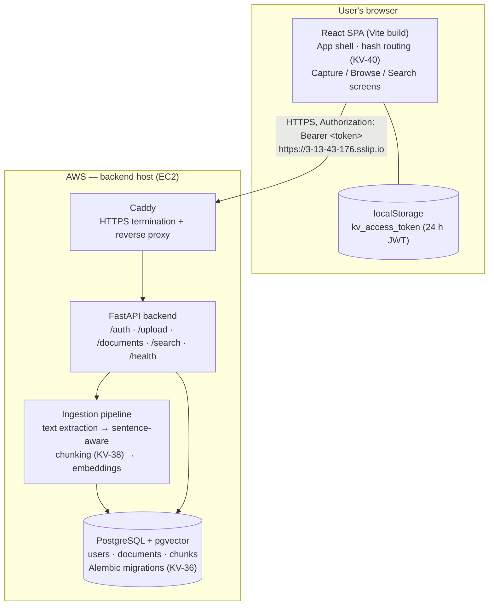

# KnowledgeVault — Architecture

_KV-45 deliverable. Frontend: Percival Tapera. Backend: Durvank Deorukhkar.
This document describes the system as built at the end of Sprint 4
(Nov 12, 2026); the deployment section separates what is live today
from the Sprint 4 hosting target._

## Overview

KnowledgeVault is a personal document archive with semantic search. A
user signs up, uploads PDFs and text notes, and can then browse the
archive or search it in natural language: the backend extracts each
document's text, splits it into sentence-aware chunks, embeds the
chunks, and answers searches by vector similarity, returning the
best-matching snippet per document. Every document is owned by the
account that uploaded it; one user can never see another's documents
(the API returns 404, not 403, for someone else's document id).

## System diagram



## Components

### Frontend (React 18 + Vite, no router library)

| Piece | File | Responsibility |
|---|---|---|
| App shell | `frontend/src/App.jsx` | Top bar + sidebar layout, backend status indicator, sign-in gate (KV-43), hash routing between tabs (KV-40). Screens stay mounted while hidden so state survives tab switches (KV-31). |
| Capture | `frontend/src/screens/UploadScreen.jsx` | Upload a PDF or enter/paste a note or article; shows the saved record, duplicate warnings and enrichment results (KV-19). |
| Browse | `frontend/src/screens/BrowseScreen.jsx` | Document list with type/tag filters and sorting, master–detail pane with the source excerpt, delete with confirmation (KV-17, KV-22, KV-30). |
| Search | `frontend/src/screens/SearchScreen.jsx` | Semantic search; ranked results with relevance bar, snippet, tags and summary (KV-18, KV-31). |
| Auth | `frontend/src/screens/AuthScreen.jsx` | Sign in / sign up against `/auth/*`; stores the issued token (KV-43). |
| API client | `frontend/src/api.js` | All backend calls. Attaches the Bearer token, converts error bodies into `Error` objects carrying `status`, `detail` and `code`, and triggers the session reset on a 401 from a protected route. |
| Session | `frontend/src/auth.js` | Token storage in localStorage plus the unauthorized-handler bridge between `api.js` and the shell. |
| Excerpts | `frontend/src/excerpt.js` | Pulls a display excerpt out of a document record across the backend's historical field names, with a chunk fallback. |

Quality gates (KV-39, KV-44): a Vitest + React Testing Library suite
covers the session, API client, excerpt helper, auth screen and shell
routing; ESLint runs in CI alongside the tests and a production build.
Accessibility: labelled controls, visible focus outlines, grouped
filters, and reduced-motion support.

### Backend (FastAPI — Durvank)

- **Auth (KV-42 / KV-28 / KV-32):** signup/login issue a 24-hour JWT;
  passwords are bcrypt-hashed. Every route except `/health` requires
  the token, and document queries are scoped to the token's user.
- **Ingestion:** upload stores the document, extracts text, splits it
  with sentence-aware chunking (KV-38), embeds the chunks, and enriches
  the record with tags and a summary.
- **Search:** the query is embedded and matched against chunk vectors
  in pgvector; results are grouped to one best snippet per document.
- **Data:** PostgreSQL with the pgvector extension; schema managed by
  Alembic migrations (KV-36). Deleting a document cascades to its
  chunks and embeddings.

## Key flows

**Sign-in.** `POST /auth/login` → `{ access_token }` → stored in
localStorage → sent as `Authorization: Bearer …` on every later call.
A 401 from any protected route clears the token and returns the user
to the sign-in screen; a 401 from the auth calls themselves is shown
as a form error instead (e.g. `invalid_credentials`).

**Upload.** Capture posts the file as multipart form data to
`POST /upload`. The response is the saved record once ingestion and
enrichment complete; re-uploading identical content returns the
existing document's identity so the UI can warn about the duplicate
(KV-25).

**Search.** `POST /search { query, limit }` → ranked results, one per
document, each with snippet, similarity score, tags and summary. The
UI normalises scores against the top result for the relevance bar.

## Deployment

- **Today (development):** the backend runs on an AWS EC2 instance
  behind Caddy, which provides HTTPS at
  `https://3-13-43-176.sslip.io`; the frontend runs locally
  (`VITE_API_URL` points at the backend) and the backend's CORS
  allowlist currently permits the local dev origin only.
- **Sprint 4 target:** the frontend is a static Vite build, so it
  deploys to S3 + CloudFront; hash routing (KV-40) was chosen because
  it needs no history-API rewrites from the static host. Once the
  deployed frontend URL exists it must be added to the backend's CORS
  allowlist.

## Repository layout

```
frontend/   React SPA (this document's frontend sections)
backend/    FastAPI service, ingestion pipeline, Alembic migrations
.github/workflows/   CI — frontend lint/tests/build (KV-39), backend checks
```
