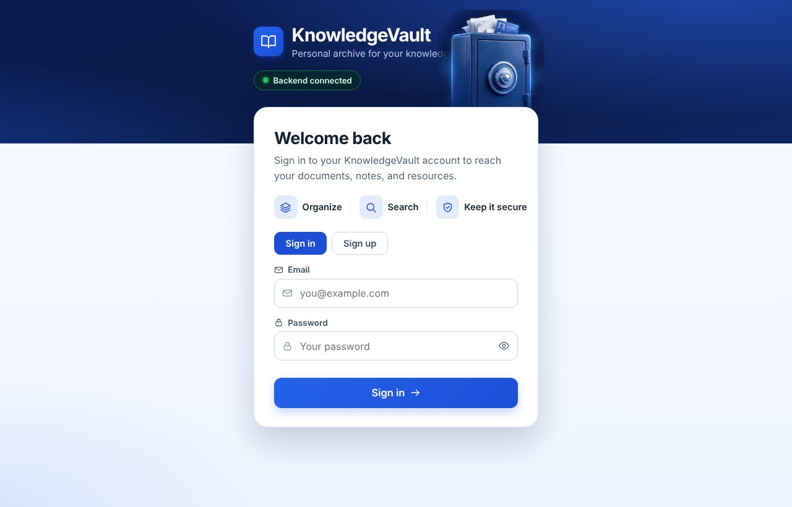
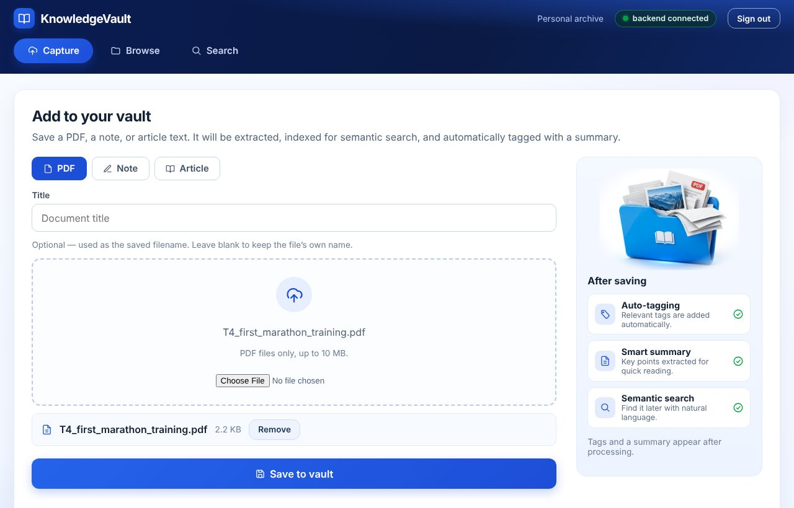
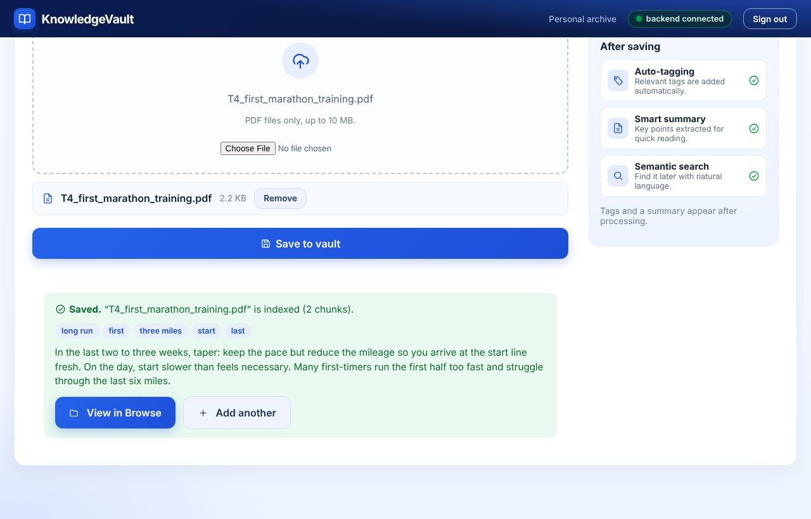
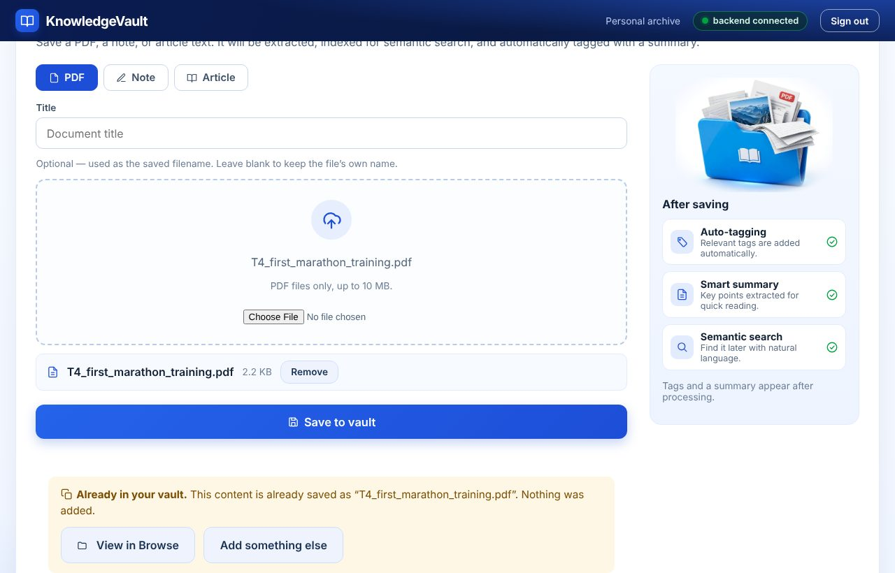
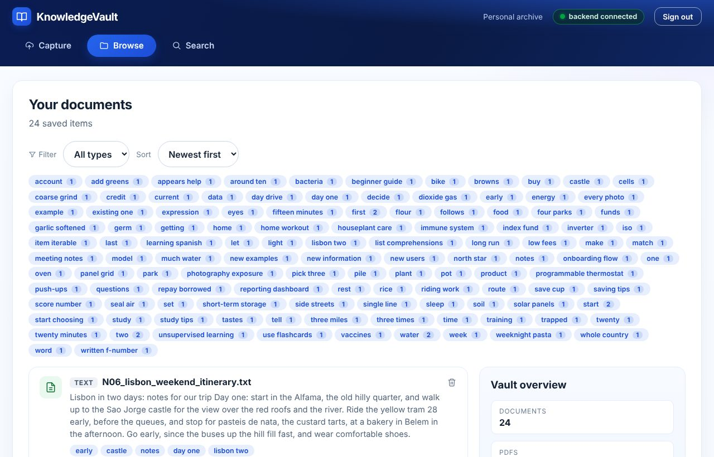
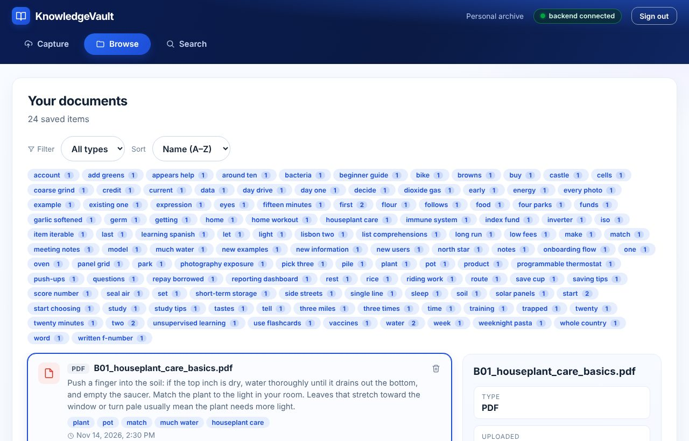
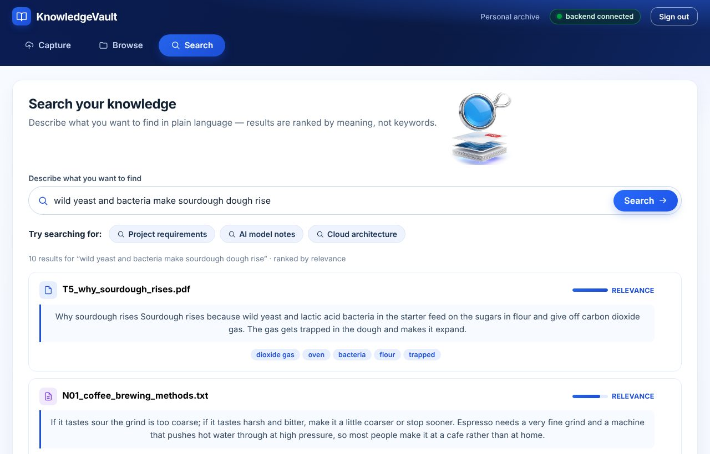

# KnowledgeVault user guide

KnowledgeVault is a personal archive for your notes, PDFs and articles. You add
documents, and later you find them by describing what they were about, in your
own words, instead of remembering a file name or the exact words in them.

Open the app at <https://d33bsamq53gtgw.cloudfront.net> in any current browser.
(Running your own copy? See the [README](../README.md#run-it-on-your-own-machine).)

## 1. Create an account and sign in

1. On first use choose **Sign up**, enter your email and a password of at least
   8 characters, and press the button. You are signed in straight away.
2. Next time choose **Sign in**. The eye icon in the password box shows or hides
   what you typed.
3. **Sign out** (top right) ends your session. A sign-in lasts 24 hours.

Your documents belong to your account. Nobody else can see or search them. After
five wrong passwords for the same email, sign-in pauses for up to 10 minutes; the
screen tells you how long to wait.

## 2. Add a document (Capture)

Open **Capture** and pick what you are adding:

- **PDF:** choose a PDF file, up to 10 MB.
- **Note** or **Article:** type or paste the text into the box, or load a `.txt`
  file. Notes and articles are stored the same way; the choice is only a label.

The **Title** is optional. It becomes the saved name; leave it empty to keep the
file's own name, or to use the first line of a note.

Press **Save to vault**. After a few seconds you see a green confirmation with
the document's automatic **tags** and a short **summary**:

**View in Browse** opens the document in your list; **Add another** clears the
form. Behind the scenes the text is extracted, split into passages, indexed by
meaning, tagged and summarised. You do not have to do anything else.

### If something is not accepted

KnowledgeVault says why and saves nothing. Common cases:

| You see | What to do |
|---|---|
| "Already in your vault" (yellow) | The same content is already saved. Use **View in Browse** to open the existing copy. |
| Not a PDF or a text file | Only PDF and plain text files are supported. |
| Larger than 10 MB | Split the file or choose a smaller one. |
| The file is empty or has no text | A scanned PDF is a picture of text, with nothing to read. Use a PDF with real text. |
| The PDF needs a password, or is damaged | Remove the password, or export the PDF again. |
| Too much text | One document can hold about 160 pages of text. Split it. |

## 3. Browse your documents

**Browse** lists everything you have saved, newest first, with a short excerpt,
the tags and the date.

- **Filter** by type (all, PDFs, text) or click a **tag** to show only documents
  with it. Click the tag again to clear it.
- **Sort** by newest, oldest or name (A to Z).
- Click a document to open its details on the right: type, upload time, size,
  tags and a preview of its text.
- The trash icon deletes a document and everything derived from it, after a
  confirmation. Deleting cannot be undone.

## 4. Search

Open **Search** and describe what you are looking for in plain language, then
press **Search**. You do not need the words that are in the document: "why do I
feel tired and sore the day after an injection" finds a document about how
vaccines work.

- Results are ranked by meaning, **one per document**, best first.
- Each result shows the **passage** that matched best, the document's tags, and
  a **relevance** bar. The bar compares results with the top one for this search;
  it is not a percentage of correctness.
- Results that are only weakly related are hidden, so a search for something you
  never saved correctly shows nothing.
- Click a result to preview the document. Before you search, three cards under
  the search box open Browse filtered to PDFs, to text, or to everything.

Tips for better results:

- Describe the idea in a sentence rather than typing one word. Short searches such
  as "compost" work, but a full question gives search more to match on.
- If nothing comes up, rephrase it with different words, or describe the document
  as you would to a friend.
- Searches can be up to 500 characters.

## 5. Troubleshooting

| Problem | Likely cause and fix |
|---|---|
| The status badge shows the backend is unreachable | The server cannot be reached. Check your connection and try again in a minute. |
| You are sent back to the sign-in screen | Your 24-hour session ended. Sign in again; nothing is lost. |
| "Too many failed sign-in attempts" | Wait the time shown, then try again. |
| A search finds nothing | Rephrase it, or check that the document was saved (look in Browse). |
| A document seems missing | You may be signed in to a different account. |

**Forgotten password:** the server can email you a reset link (valid for 30
minutes, single use), but the app does not have its reset screens yet.
